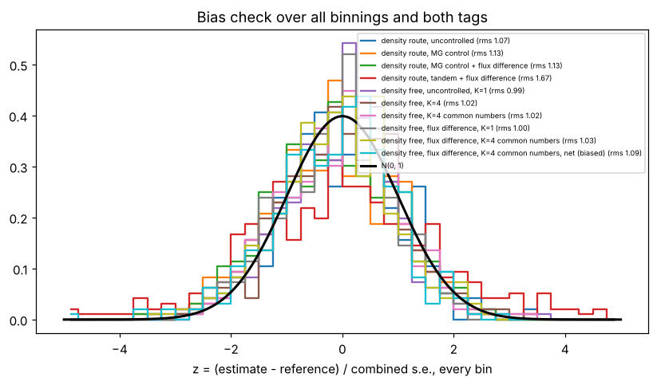
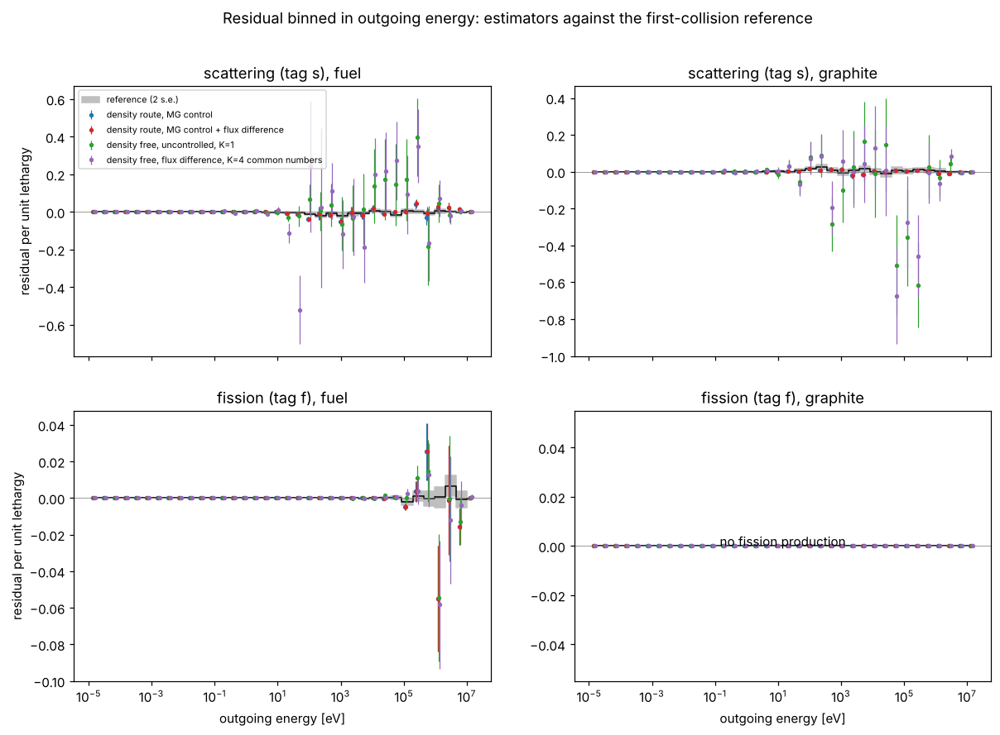
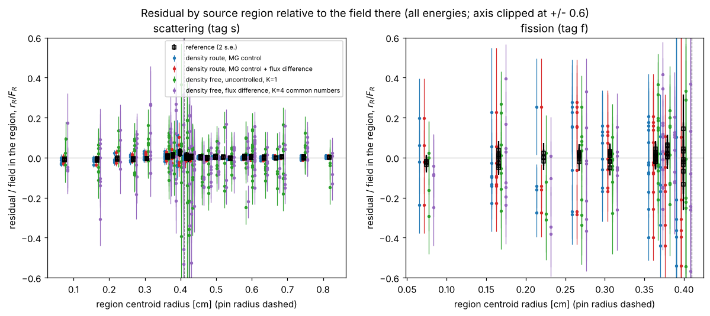
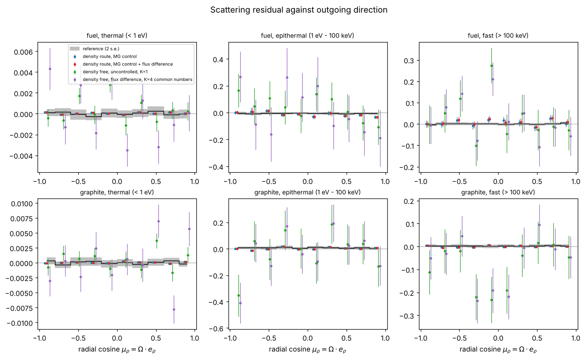
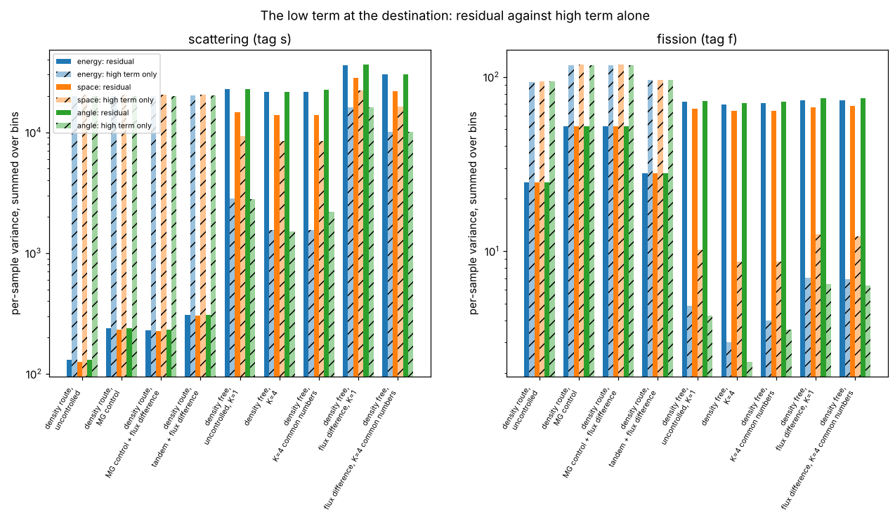
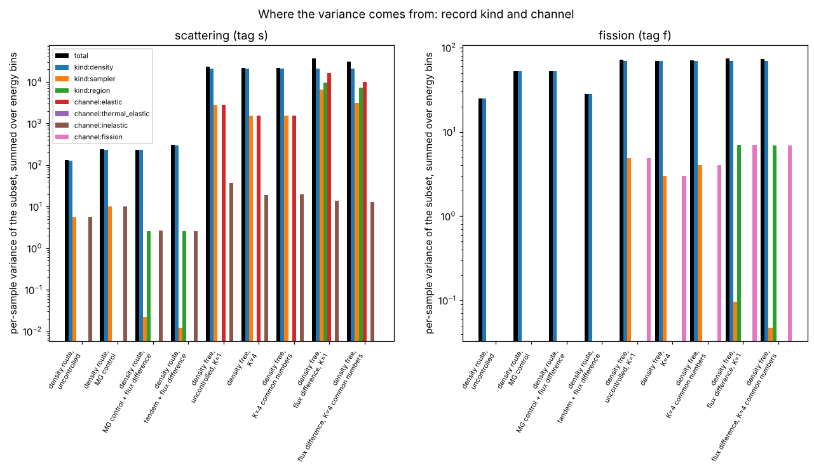
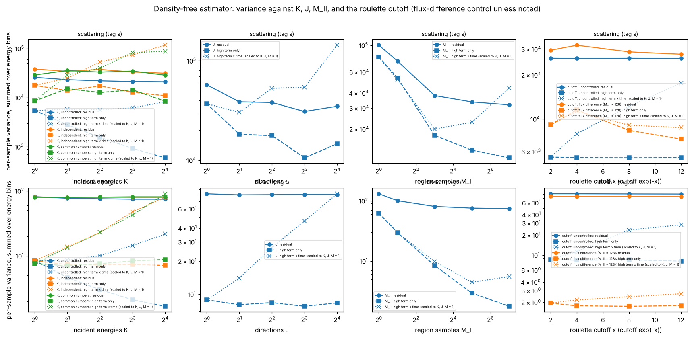
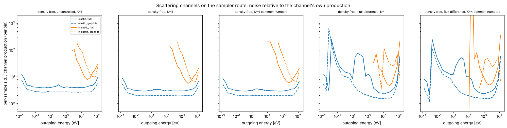
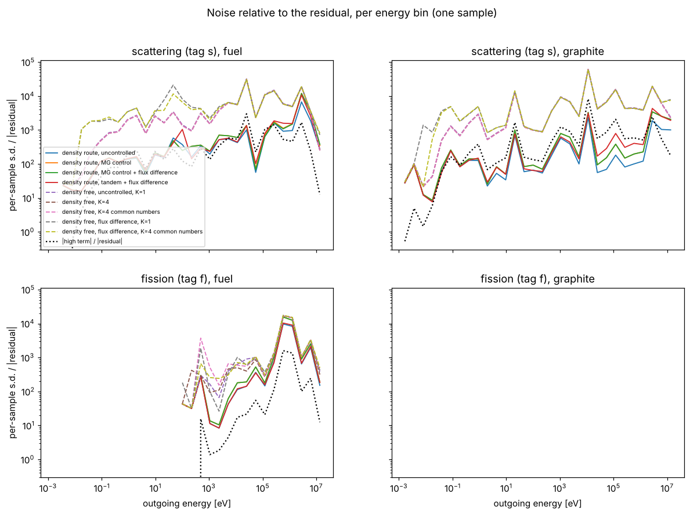
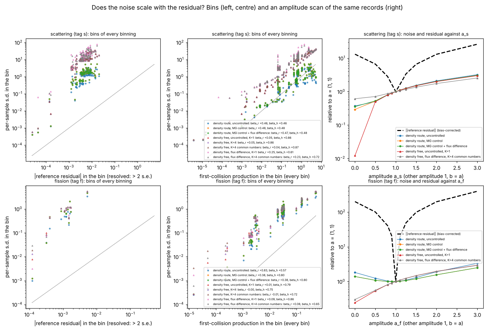

.. _devguide_rmc_controlled_residual:

===========================================================
Controlled Residual Estimators Without Consistent Densities
===========================================================

This is a study of the residual estimators, written to be lifted into a
research report. It asks whether the residual of a frozen field can be
estimated with noise on the scale of the residual itself, using OpenMC's
collision samplers alone, without a density for every continuous-energy (CE)
reaction. The theory is in :ref:`methods_rmc_sampler_control` and
:ref:`methods_rmc_residual_family`; the code is
``examples/rmc/controlled_residual_study.py`` and
``controlled_residual_figures.py``; the numbers below are in
``examples/rmc/results/controlled_residual/``.

.. contents::
    :local:
    :depth: 1

---------------
1. The question
---------------

Residual Monte Carlo pays off only if the residual

.. math::

    r_t = \mathcal{K}_t Q_a - b_t\, Q_{t}, \qquad Q_a = a_s Q^{MG}_s + a_f
    Q^{MG}_f,

is estimated with noise that shrinks with :math:`r_t`, not with the
production :math:`\mathcal{K}_t Q_a`. Here :math:`\mathcal{K}_t` is the CE
first-collision production of tag :math:`t` (scattering :math:`s`, fission
:math:`f`). Two things can make the noise residual-scale:

1. **Pointwise cancellation.** High and low terms evaluated at the same
   outgoing state :math:`(\mathbf{r}, E, \mathbf{\Omega})` cancel record by
   record. That needs the CE production density at a chosen state, which
   OpenMC provides only through the evaluators of Stage 3 (stationary-target
   elastic, fission).
2. **A control variate.** A cheap approximation of :math:`\mathcal{K}_t Q_a`
   whose mean is known, subtracted on the same random numbers.

For reactions without an evaluator (free-gas and resonance elastic,
S(:math:`\alpha,\beta`), inelastic levels and continuum,
:math:`(n,xn)`), OpenMC only *samples* an outgoing state. The question is
whether that route can be controlled at all, and if not, whether an
uncontrolled one already defeats the method. Building consistent densities
for every reaction is a separate, larger effort; this study decides whether
it is needed.

---------------------------
2. The estimators compared
---------------------------

Every estimator draws :math:`N` destinations per tag, an outgoing state at
each, and :math:`J` incident directions with one backward CE trace each
(:ref:`methods_rmc_residual`). They differ in how the incident energy and
reaction are handled. Two classes:

.. list-table:: Estimator classes
    :header-rows: 1
    :widths: 18 30 26 26

    * - Class
      - Elastic (stationary target) and fission
      - Other channels
      - Low term :math:`b_t Q_t`
    * - **Density route**
      - evaluator at the destination's outgoing state (images in
        :math:`E'` for elastic; one drawn :math:`E'` for fission)
      - sampler route: drawn :math:`E'`, OpenMC's routine, a new outgoing
        state
      - at the destination's outgoing state, so it cancels the evaluator's
        production pointwise
    * - **Density free** (``all_sampler``)
      - sampler route (``elastic_scatter``, ``sample_fission``,
        ``sample_fission_neutron``)
      - sampler route
      - at the destination's outgoing state, which no sampled particle
        shares

Options within a class:

.. list-table:: Options
    :header-rows: 1
    :widths: 24 56 20

    * - Option
      - What it does
      - Bias
    * - MG control (:math:`c=1`)
      - P\ :sub:`0` MG production on the same path, with its mean restored
        on :math:`L` MG-only directions (density branch only)
      - none
    * - Tandem (sweep, :math:`\lambda = 1`)
      - directions from a random ray sweep's segments; the low term is the
        sweep's emission
      - none over sweeps
    * - :math:`K` incident energies
      - :math:`K` draws of :math:`E'` per direction share one trace
      - none
    * - Common random numbers
      - the :math:`K` samplers start from one stream
      - none
    * - Flux-difference control
      - term I on the path with :math:`\psi - \phi_R h^{\phi}/4\pi`, term II
        by :math:`M_{II}` forward samples from the region's lifted flux
        (eq. :eq:`rmc-flux-difference`)
      - none
    * - Net assignment
      - one of the :math:`K` outgoing states carries their net
      - **biased**

The ten variants run (``VARIANTS`` in the script), four of them shown in the
binned figures:

.. list-table::
    :header-rows: 1
    :widths: 52 10 8 8 22

    * - Variant
      - :math:`J`
      - :math:`K`
      - :math:`M_{II}`
      - Control
    * - density route, uncontrolled
      - 8
      - 1
      - --
      - none
    * - density route, MG control
      - 4 (+4)
      - 1
      - --
      - MG
    * - density route, MG control + flux difference
      - 4 (+4)
      - 1
      - 8
      - MG, flux difference
    * - density route, tandem + flux difference
      - 8 segments
      - 1
      - 8
      - MG (sweep), flux difference
    * - density free, uncontrolled, K=1
      - 8
      - 1
      - --
      - none
    * - density free, K=4 (independent / common numbers)
      - 4
      - 4
      - --
      - none
    * - density free, flux difference, K=1
      - 8
      - 1
      - 8
      - flux difference
    * - density free, flux difference, K=4 common numbers
      - 4
      - 4
      - 8
      - flux difference
    * - ... , net (biased)
      - 4
      - 4
      - 8
      - flux difference

All variants use the same destination stream (seed per tag), so their
comparisons share most of the low-term noise. That sharpens differences
between variants; it also means their bias tests are not independent.

--------------------------------
3. Problem, reference, binnings
--------------------------------

**Problem.** The graphite pincell of ``problems.graphite_pincell``
(3.1 % enriched UO\ :sub:`2`, graphite moderator, reflective on every face,
12 x 12 source-region mesh, 172 regions, CASMO-8), with the field of the
visual checks (random ray, 500 rays x 500 batches; :math:`k_{MG} = 0.6426`).
Matched physics: no probability tables, stationary target above
:math:`10^{-6}kT`.

**Reference.** Parents are drawn from each field component separately
(:math:`Q_s` alone, :math:`Q_f` alone): a uniform point in the box, a group
in proportion to the region's emission, and a log-uniform energy in the
group, weighted by :math:`4\pi V_{box}\,q/p`. One forward flight of each,
with OpenMC's collision routines (``rmc.propagate``, Stage 5), gives the
first-collision production by tag at the child's state. By linearity the
reference for any amplitudes is :math:`a_s\,\mathrm{Ref}_s +
a_f\,\mathrm{Ref}_f`, and the residual subtracts :math:`a_t F_t`, the field
integrated exactly from the lifts. :math:`2.4\times10^7` flights per
component in 24 independent chunks give the reference's standard errors. The
parents' summed weight matches the field mass to :math:`2\times10^{-4}` (s)
and :math:`2\times10^{-4}` (f).

The field integral uses *geometric* region volumes (a 4001 x 4001 grid in
the plane). The field's own volumes :math:`V_A` come from point sampling,
and in the small regions cut by the pin surface they are off by several per
cent; both the estimators and the reference see the geometry, not
:math:`V_A`. With :math:`V_A` the regions at the interface showed
:math:`|z|` up to 13 for every density-route variant, an artefact of the
reference, not of the estimators.

**Binnings.**

- *Energy:* material (fuel, graphite) x 36 logarithmic outgoing-energy bins,
  :math:`10^{-5}` eV to 20 MeV.
- *Space:* the field region (172), all energies, shown against the region's
  centroid radius and relative to its field :math:`F_R`.
- *Angle:* material x energy range (thermal :math:`<` 1 eV, epithermal,
  fast :math:`>` 100 keV) x 10 bins of the radial cosine
  :math:`\mu_\rho = \mathbf{\Omega}\cdot\mathbf{e}_\rho` of the outgoing
  direction. The field is isotropic, so :math:`F` in an angle bin is its
  range integral times :math:`\Delta\mu_\rho/2`.

**Statistics.** Each destination with all its records is one draw. A bin's
estimate is the sum of weights, its standard error the spread of the
per-destination totals. "Per-sample variance" below is :math:`N` times the
squared standard error, summed over the bins of a binning. Main variants use
:math:`N = 40{,}000` per tag; parameter scans :math:`N = 10{,}000`.

-----------------
4. Unbiasedness
-----------------

    Standardized differences from the reference over every bin of the
    three binnings and both tags. Only bins where both sides have a standard
    error are counted.

.. list-table:: :math:`\chi^2`/bins against the reference, tag :math:`s`
    :header-rows: 1
    :widths: 52 16 16 16

    * - Variant
      - energy
      - space
      - angle
    * - density route, uncontrolled
      - 78/58
      - 195/172
      - 58/60
    * - density route, MG control
      - 79/58
      - 214/172
      - 60/60
    * - density route, tandem + flux difference
      - 86/58
      - 782/172
      - 83/60
    * - density free, uncontrolled, K=1
      - 62/58
      - 148/172
      - 84/60
    * - density free, flux difference, K=4 common numbers
      - 74/58
      - 152/172
      - 98/60
    * - ... net (biased)
      - **114/58**
      - 153/172
      - 84/60

All unbiased variants agree with the reference in energy and in angle within
about 3 standard errors per bin. The excesses in the angle binning of the
density-free variants share one pattern of :math:`z` (the variants share
their destinations), and the largest :math:`|z|` is 3.6 over 120 bins. The
tandem's space :math:`\chi^2` is expected: with one sweep fixed for all
samples, the segment directions are a fixed quadrature, so the estimate is
unbiased over sweeps but not given one, and its error is largest in the
small regions at the pin surface that few segments cross. The net
assignment is detected as biased in energy (:math:`|z|_{max} = 5.8`).

The same variants pass the first-collision gate of Stage 4
(``tests/rmc/test_residual_first_collision.py``, OpenMC's own tallies), and
the infinite-medium means (``tests/rmc/test_residual.py``):
``all_sampler`` reproduces the whole production of each tag with :math:`K =
3`, with and without common numbers, and the two parts of the
flux-difference control have opposite means.

-------------------------------------------
5. The residual in energy, space, and angle
-------------------------------------------

    Residual per unit lethargy, :math:`a = b = (1, 1)`, :math:`k = k_{MG}`.
    Grey band: reference :math:`\pm 2` s.e. Points: 40,000 samples per tag.

The field's residual is small: at most a few per cent of the production in
any bin, largest above 100 eV in the fuel (U-238 resonances, the region
where a P\ :sub:`0` 8-group field is least accurate) and around 0.1-10 MeV in
fission. The density-route estimates follow the reference band. The
density-free estimates scatter by 10-100 times the residual in the same
bins.

    Residual by field region relative to the field there, :math:`r_R/F_R`,
    against the region's centroid radius (pin surface dashed).

In space the reference residual is within :math:`\pm 3` % of the field
everywhere except the regions cut by the pin surface, where it reaches
:math:`\pm 15` % (the field is flat within a region, the true production is
not). The density route resolves these; the density-free estimators do not
at this sample size.

    Scattering residual against the radial cosine of the outgoing direction.

The scattering residual has no angular structure the reference can resolve
at this level, so the angle binning tests the estimators' noise in
direction: the density route resolves zero; the density-free variants
scatter by 0.1-0.3 in fast and epithermal bins.

---------------------------------
6. Where the variance comes from
---------------------------------

    Per-sample variance of the residual (solid) and of the high term alone
    (hatched), per binning. The high term alone is the same records with
    :math:`b = 0`: the noise that remains if the low term is removed exactly.

    Variance of the records of each kind and channel, energy binning.

.. list-table:: Per-sample variance summed over energy bins
    :header-rows: 1
    :widths: 46 13 13 14 14

    * - Variant
      - :math:`s`: residual
      - :math:`s`: high only
      - :math:`f`: residual
      - :math:`f`: high only
    * - density route, uncontrolled
      - **130**
      - 19,900
      - **24.7**
      - 93.7
    * - density route, MG control
      - 238
      - 20,000
      - 52.1
      - 117
    * - density route, tandem + flux difference
      - 308
      - 20,100
      - 27.9
      - 95.8
    * - density free, uncontrolled, K=1
      - 22,800
      - 2,840
      - 72.0
      - 4.86
    * - density free, K=4
      - 21,500
      - 1,560
      - 69.7
      - 3.00
    * - density free, K=4 common numbers
      - 21,500
      - 1,550
      - 70.7
      - 3.99
    * - density free, flux difference, K=1
      - 35,900
      - 16,000
      - 73.7
      - 7.07
    * - density free, flux difference, K=4 common numbers
      - 30,100
      - 10,100
      - 73.6
      - 6.92

Three findings.

1. **Pointwise cancellation is the density route's whole advantage.** Its
   high term alone is the noisiest of all (about :math:`2\times10^4` for
   scattering), because the elastic evaluator's image densities carry large
   weights. At the destination's state the low term removes 99.3 % of it
   (to 130). Nothing else in the family comes close.
2. **The density-free residual is dominated by the low term.** In every
   density-free variant the density-branch records, which carry only
   :math:`-b_t U`, account for :math:`2.05\times10^4` of the scattering
   variance and 69 of the fission variance. The sampled particles never land
   on the destination's state, so the low term's binned noise is the noise of
   estimating the field itself by sampling: production-scale.
3. **The sampled high term is good.** Without the low term, the
   density-free high term is 7 times quieter than the density route's for
   scattering and 19 times for fission at :math:`K = 1`, and 33 and 56 times
   at :math:`K = 16`. OpenMC's samplers estimate the production well; what
   they cannot do is meet the low term.

By channel (scattering), elastic carries almost all of the sampled variance
(2,790 of 2,840 at :math:`K = 1`); inelastic and :math:`(n,xn)` 37. The
graphite here has no S(:math:`\alpha,\beta`) table, so the thermal elastic
channel is empty.

------------------------------------------
7. Incident energies, directions, control
------------------------------------------

    Density-free scans (:math:`N = 10{,}000` per point, flux-difference
    control unless noted). Circles: residual; squares: high term alone;
    crosses: high term x time, scaled to the first point.

- **K, uncontrolled.** The high term falls from 5,460 to 597 for scattering
  and 8.4 to 1.7 for fission as :math:`K` goes from 1 to 16, roughly as
  :math:`K^{-0.8}` and :math:`K^{-0.6}`. The cost per sample grows almost
  linearly (the trace is shared, the collision samples are not), so
  variance x time is flat to slightly worse. More incident energies help only
  where tracing dominates the cost.
- **Common random numbers.** No gain over independent draws in these
  outgoing-energy bins: the outgoing states of different :math:`E'` separate
  quickly (elastic kinematics scale with :math:`E'`), so they rarely share a
  bin.
- **J.** The high term falls from :math:`3.7\times10^4` to
  :math:`1.1\times10^4` from :math:`J = 1` to 8; variance x time is flat.
- **M_II.** The region term is production-scale: the high term with control
  falls from :math:`8.0\times10^4` (:math:`M_{II} = 1`) to
  :math:`1.15\times10^4` (128) for scattering and 62 to 1.8 for fission. Its
  floor is term I.
- **Roulette cutoff.** Longer backward tails do not change the uncontrolled
  variance (5,500 at every cutoff) and reduce the controlled one only from
  :math:`1.15\times10^4` to :math:`7.3\times10^3` at :math:`e^{-12}`.
  The tail is not what limits term I.

**The flux-difference control.** For fission it works: at
:math:`M_{II} = 128` the high term's variance is 1.8 against 8.4
uncontrolled at the same :math:`J` and :math:`K`, because the fission
spectrum barely depends on :math:`E'` and the region's isotropic flux
captures the incident integral well. For scattering it makes things worse
(term I's floor, about :math:`7`-:math:`11\times10^3`, is above the
uncontrolled 5,500). The isotropic, region-averaged, lifted flux is a poor
pointwise match to the path's :math:`\psi(E')` in the fuel's resonances and
at the pin surface, and term I adds the variance of :math:`\phi_R h^{\phi}`
along with removing that of :math:`\psi`. Per channel, the control lowers
the elastic noise relative to production above 100 keV in both materials
and raises it below (figure below).

    Scattering channels of the density-free variants: per-sample standard
    deviation over the channel's own production, per energy bin.

The **net assignment** gives no gain (high term :math:`1.09\times10^4`
against :math:`1.01\times10^4` with the :math:`K` particles kept) and is
biased. The :math:`K` outgoing states of one direction land in different
bins, so there is little to net locally.

-----------------------------------------------
8. Does the noise scale with the residual?
-----------------------------------------------

    Per-sample standard deviation over :math:`|r|` per energy bin; dotted:
    :math:`|\text{high term}|/|r|`. An estimator with residual-scale noise
    would sit near 1; one with production-scale noise sits near the dotted
    line or above.

    Left and centre: per-sample standard deviation per bin (every binning)
    against the reference residual and against the production. Right: the
    same records weighted for amplitudes :math:`a = b = (x, 1)` (tag
    :math:`s`) or :math:`(1, x)` (tag :math:`f`); the residual's norm
    changes by a factor of 10-400, the noise follows the amplitude.

**Fit.** Over the bins where the reference resolves the residual (93 for
scattering, 12 for fission), :math:`\log\sigma = \alpha + \beta_r\log|r| +
\beta_h\log h`:

.. list-table::
    :header-rows: 1
    :widths: 52 12 12 12 12

    * - Variant
      - :math:`s`: :math:`\beta_r`
      - :math:`s`: :math:`\beta_h`
      - :math:`f`: :math:`\beta_r`
      - :math:`f`: :math:`\beta_h`
    * - density route, uncontrolled
      - 0.46
      - 0.46
      - 0.83
      - 0.57
    * - density route, uncontrolled, high term only
      - 0.03
      - 0.88
      - 0.50
      - 0.76
    * - density route, MG control
      - 0.48
      - 0.48
      - 0.38
      - 0.80
    * - density free, uncontrolled, K=1
      - 0.05
      - 0.86
      - 0.01
      - 0.79
    * - density free, K=4 common numbers
      - 0.04
      - 0.87
      - -0.01
      - 0.72
    * - density free, flux difference, K=4 common numbers
      - 0.23
      - 0.72
      - 0.08
      - 0.65

:math:`\beta_r = 1, \beta_h = 0` would be residual-scale noise;
:math:`\beta_r = 0, \beta_h = 1` production-scale. The density route is
halfway for scattering, through the pointwise cancellation; its high term
alone is production-scale. Every density-free variant is production-scale,
with the flux-difference control moving a quarter of the way. The fission
fits rest on 12 bins and are indicative only.

**Amplitude scan.** Changing :math:`a_s` from 1 to 0 or 3 makes the
scattering residual's norm 13 to 25 times larger; changing :math:`a_f`
makes the fission residual 200 to 400 times larger. The noise of every
estimator changes by at most a factor of 3, in proportion to the high term
(the density route's fission noise rises by 1.8 at :math:`a_f = 0`, where
the pointwise cancellation is lost). No estimator in the family has noise
that falls with the residual at :math:`a = (1, 1)`: at the converged field,
the remaining noise is the integration noise of the high term in
:math:`\mathbf{\Omega}'` and :math:`E'`, partly cancelled pointwise on the
density route and not at all on the sampler route.

--------------
9. Conclusions
--------------

1. **An uncontrolled density-free estimator defeats the purpose.** Its
   residual is 175 times noisier than the density route's for scattering and
   3 times for fission, and *noisier than its own high term*: estimating
   :math:`\mathcal{K}Q - Q` by sampling both parts independently is worse
   than estimating :math:`\mathcal{K}Q` alone. This is settled a priori by
   the variance decomposition and confirmed in every binning.
2. **The obstacle is the low term, not the sampler.** OpenMC's samplers
   estimate the high term 7-56 times better than the evaluators do. The
   density-free method fails only because its particles do not meet the
   low term's records.
3. **Region-level control does not replace pointwise cancellation.** The
   flux-difference control is unbiased and needs no density and no extra
   trace. It helps fission (4.7 times on the high term at
   :math:`M_{II} = 128`) and hurts scattering. No member of the family
   reaches residual-scale noise; the density route reaches about
   :math:`\sigma \propto |r|^{0.5}h^{0.5}`.
4. **What would make the density-free route work** is a mechanism that
   meets the low term: cancellation of the sampled high-term particles
   against the low-term particles in a common representation (Stage 8,
   binned netting), or a low term that is not sampled at all. Either removes
   the 99 % of variance in finding 2, after which the density-free estimator
   is the better of the two classes. Exact cancellation, which needs
   densities, is the longer road.

**What this study does not show.** One problem, one field, one
temperature; a field already accurate to a few per cent, so the residual is
small and hard to resolve in fission bins; no S(:math:`\alpha,\beta`); the
P\ :sub:`0` MG control only. The cost figures are for the cloud workspace
(2 cores), single-threaded.

-----------------
10. Reproducing
-----------------

.. code-block:: sh

    cd examples/rmc
    python controlled_residual_study.py --work rmc_visual_work \
        --n 40000 --n-scan 10000 --ref-flights 24000000 --ref-chunks 24 \
        --out results/controlled_residual/controlled_residual_study \
        --figures ../../docs/source/devguide/rmc_figures

About 30 minutes on two cores: 8 minutes of reference flights (cached in
``*_reference.npz`` for reruns), 10 for the main variants, 10 for the
scans. ``controlled_residual_figures.py <prefix> <dir>`` redraws every figure
from the stored results and writes ``<prefix>_fits.json`` (noise fits and
the bias table).
