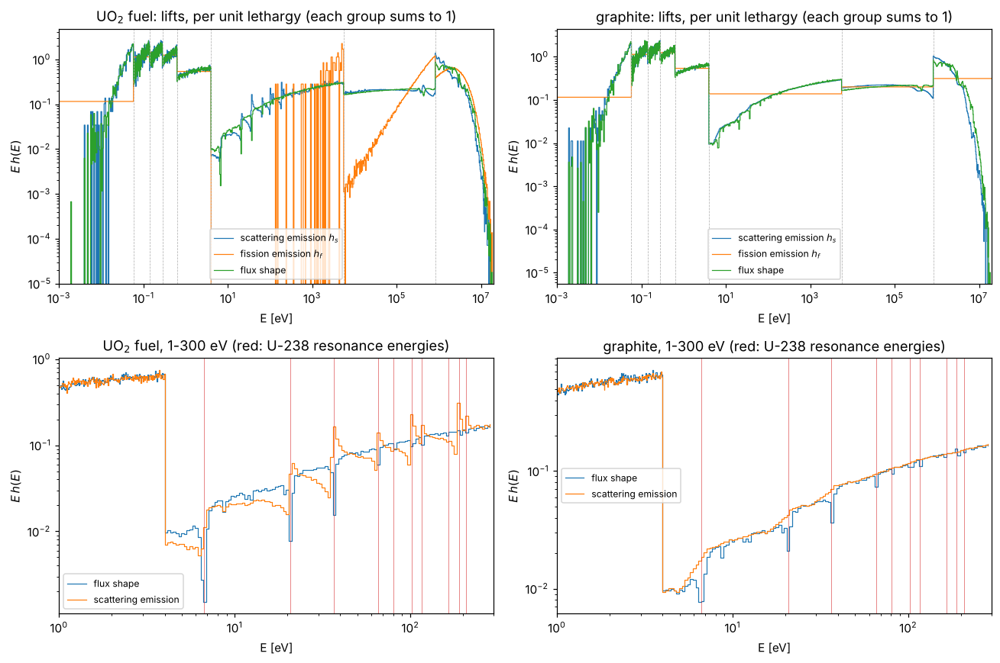
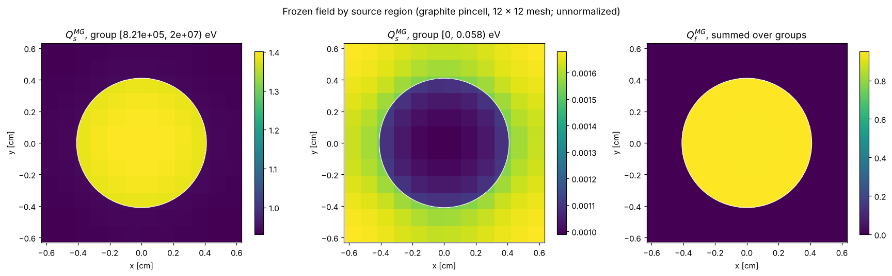
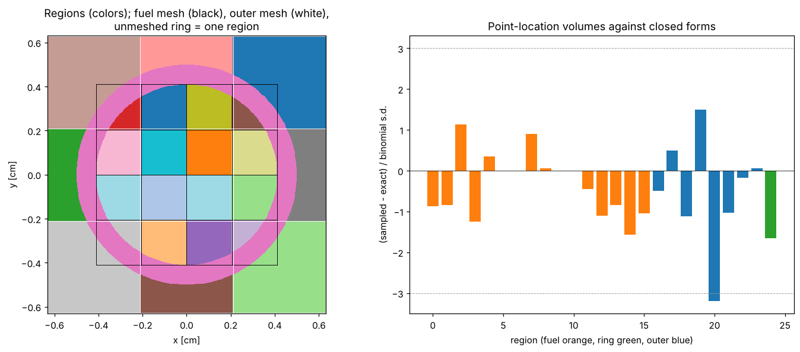
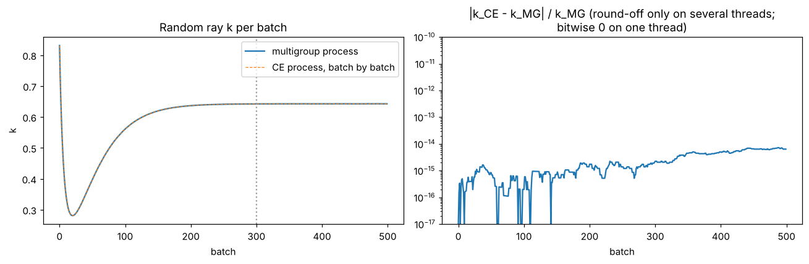
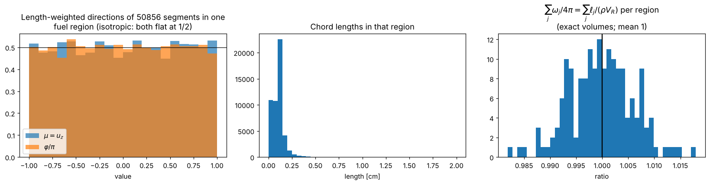
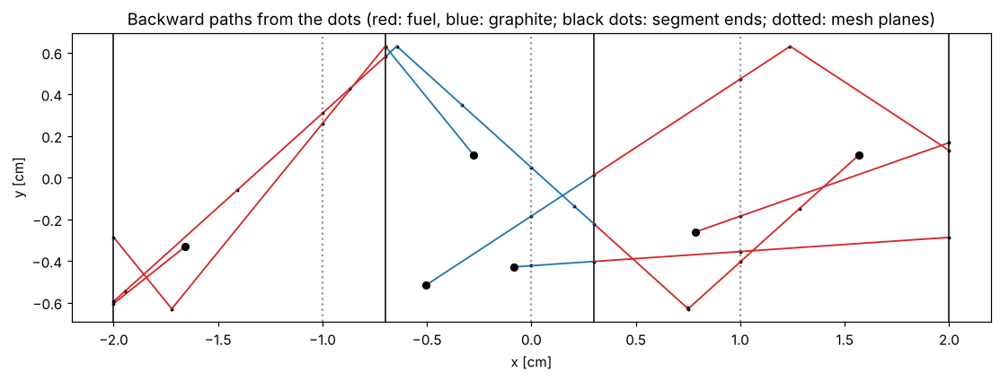
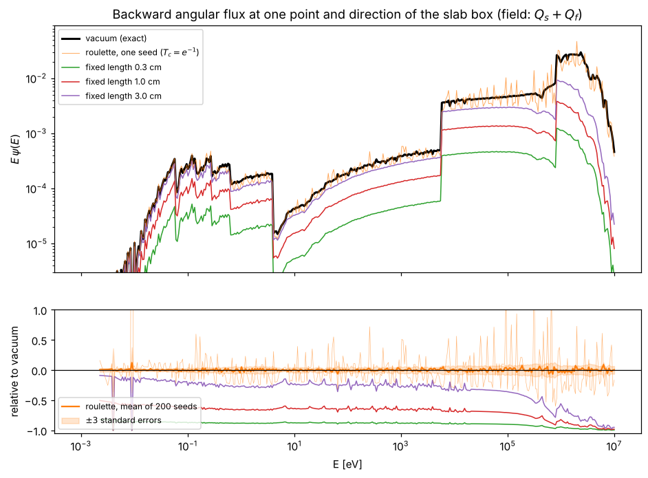
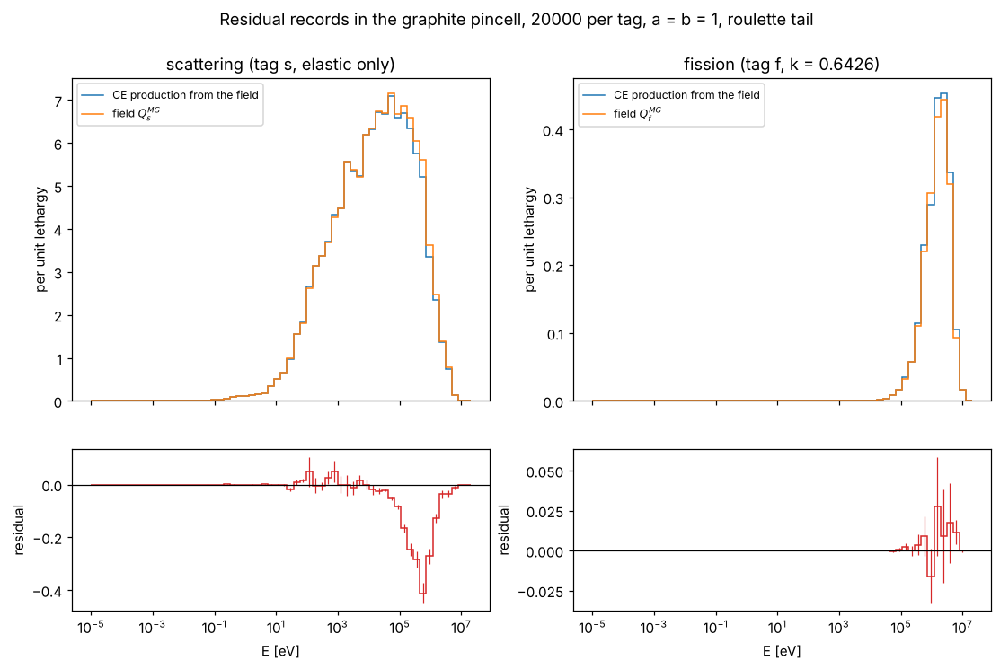

.. _devguide_rmc_visual:

===================================
Residual Monte Carlo: Visual Checks
===================================

The tests of :ref:`devguide_rmc` check each component against a reference
with a numerical criterion. This page shows the same components as pictures,
so that a reader can see that they behave as intended. Every figure is made
by one function of ``examples/rmc/visual_checks.py``, shown below the figure.

.. contents::
    :local:
    :depth: 1

Running the script
------------------

From ``examples/rmc``, with ``OPENMC_CROSS_SECTIONS`` set and ``openmc.lib``
loading a build that contains the RMC library::

    python visual_checks.py --out ../../docs/source/devguide/rmc_figures
    python visual_checks.py --out /tmp/figs lifts tracer   # selected figures

The first run builds every file it needs (multigroup random ray solves, the
lift tallies, short random ray runs for the split-mesh and slab problems)
in ``--work`` (default ``./rmc_visual_work``). This takes about fifteen
minutes on two cores, mostly the graphite pincell's random ray solve and the
lift tallies. Later runs reuse the files; delete the directory to rebuild.

The settings at the top of the script are the only parameters:

.. literalinclude:: ../../../examples/rmc/visual_checks.py
    :language: python
    :start-after: # Settings:
    :end-before: # -----

Lifts
-----

    Within-group emission shapes and flux shape of the fuel (left) and the
    graphite (right) of the graphite pincell, on a grid of 200 bins per
    CASMO-8 group, per unit lethargy. Dashed lines are group edges. The
    bottom row zooms into 1-300 eV, with the U-238 resonance energies in red.

What to look for:

- **Each group is normalized separately**, so the curves jump at group edges.
  Within a group, the shape is what the field uses to place emission in
  energy.
- **Resonances are resolved in the fuel.** The flux shape dips at 6.67, 20.9,
  36.7, and 66 eV, and more weakly at higher resonances, where the grid
  (about 1.8 % of :math:`E` per bin) is coarser than the resonance widths.
  The scattering emission shows the interference structure of the U-238
  resonances. In the graphite the same dips are weaker: they are the shadow
  of the fuel's absorption, carried into the moderator by neutrons slowing
  down there.
- **Fission emission** follows the fission spectrum above about 1 MeV. Below
  a few keV almost no fission neutrons are born, so the tallied shape in
  those groups is noise around a tiny mass. That noise does not matter,
  because the group's emission :math:`Q_{f,R,g}` is itself tiny. Graphite
  has no fission at all, so its fission lift is the :math:`1/E` fallback
  (flat per unit lethargy).
- The noisy thermal tail below 0.01 eV is a statistics effect of the lift
  tallies.

.. literalinclude:: ../../../examples/rmc/visual_checks.py
    :language: python
    :pyobject: fig_lifts

The frozen field
----------------

    Scattering emission in the fastest and slowest groups, and fission
    emission summed over groups, by source region (12 x 12 mesh over the
    pincell), as the C++ field locates points.

What to look for: fast scattering and all fission are in the fuel; thermal
scattering is depressed in the fuel and highest in the corners of the
moderator, farthest from the absorbing pin. Region boundaries follow the
mesh and the pin surface, so the C++ locator assigns points correctly.

.. literalinclude:: ../../../examples/rmc/visual_checks.py
    :language: python
    :pyobject: fig_field_maps

Several meshes
--------------

    Left: regions of the split-mesh pincell, colored at random, with the
    fuel mesh (black, 4 x 4 over the pin's bounding square) and the outer
    mesh (white, 3 x 3 over the box). The graphite ring has no mesh and is a
    single region. Right: point-location volumes of every region against the
    closed-form volumes, in units of the binomial standard deviation.

What to look for: each cell is cut only by its own mesh (the fuel mesh does
not cut the ring or the outer graphite, and the outer mesh does not cut the
fuel or the ring), and the ring is one color. The volume deviations scatter
around zero with unit spread; regions wholly inside a cell (the four central
fuel voxels) have no bar, because their sampled volume is exact. With about
25 regions, one deviation near 3 is expected now and then.

.. literalinclude:: ../../../examples/rmc/visual_checks.py
    :language: python
    :pyobject: fig_split_meshes

Random ray in the CE process
----------------------------

    Left: random ray :math:`k` per batch in the multigroup run and in the CE
    process, driven one batch at a time from the field file's tables.
    Right: their relative difference.

What to look for: the curves coincide over the whole power iteration,
including the inactive batches. The difference is round-off (around
:math:`10^{-15}` to :math:`10^{-14}`) because both runs use two threads and
OpenMP reductions sum in a run-dependent order; on one thread it is exactly
zero (``tests/rmc/test_segment_records.py``).

.. literalinclude:: ../../../examples/rmc/visual_checks.py
    :language: python
    :pyobject: fig_ce_vs_mg

Segment records
---------------

    Records of ten batches. Left: directions of the segments in one interior
    fuel region, weighted by chord length. Middle: their chord lengths.
    Right: for every region, the recorded track length divided by
    :math:`\rho V_R` with the exact volume :math:`V_R`, which is
    :math:`\sum_j \omega_j/4\pi`.

What to look for:

- **Length-weighted directions are isotropic** (both histograms flat at
  1/2). Weighted by count they are not: a chord along a voxel's axis is
  longer than a diagonal one, so axial directions give fewer segments per
  unit track length. This is why the quadrature weights are proportional to
  :math:`\ell_j`.
- **The quadrature weights sum to** :math:`4\pi` **on average** in every
  region: the ratios scatter around 1 with a spread of about 1 % for ten
  batches of 500 rays.

.. literalinclude:: ../../../examples/rmc/visual_checks.py
    :language: python
    :pyobject: fig_segments

Backward tracer
---------------

    Backward paths from random starting points (large dots) in the slab box,
    projected on x-y, colored by the material of each segment, with segment
    ends as small dots. Solid vertical lines are the slab planes and vacuum
    faces, dotted lines the mesh planes.

What to look for: each path is straight between reflections at the y walls,
ends at a vacuum face (x = :math:`\pm 2`), changes color exactly at the slab
planes, and has a segment end at every slab plane, mesh plane, and
reflection. Until ``CharacteristicTracer::trace`` is written, the figure is
empty and its title says so.

.. literalinclude:: ../../../examples/rmc/visual_checks.py
    :language: python
    :pyobject: fig_tracer

Ending the backward integral
----------------------------

    Top: the backward angular flux :math:`E\,\psi(E)` of the field
    :math:`Q^{MG}_s + Q^{MG}_f` at one point of the fuel slab of the slab
    box, along a glancing direction that reflects many times off the y and z
    walls before leaving through the vacuum face at :math:`x = 2`, with the
    three tails of :ref:`methods_rmc_tails`. Bottom: each relative to the
    vacuum tail, and the mean of 200 roulette seeds with three standard
    errors.

What to look for:

- **Vacuum is the reference.** It is exact for the path, with no noise.
- **Roulette is unbiased but noisy.** One seed (thin orange) scatters about
  the exact curve by tens of percent with a deliberately high cutoff
  (:math:`T_c = e^{-1}`); the mean of 200 seeds stays inside its band. The
  few spikes near 0.01 eV are where :math:`\psi` itself is almost zero.
- **Fixed length is biased low and noise-free.** The bias is largest where
  the medium is thin, at fast energies (above about 100 keV the 3 cm path
  misses most of the flux), and smallest at resonance peaks, where
  :math:`\Sigma_t` is large and the path's first few millimeters carry
  almost all of :math:`\psi`: the dips of the ratio toward zero at the U-238
  resonances.
- The steps in :math:`E\,\psi` are group edges of the field: within a group,
  the field's energy dependence is its lift.

.. literalinclude:: ../../../examples/rmc/visual_checks.py
    :language: python
    :pyobject: fig_backward_tails

Residual records
----------------

    Records of the graphite pincell, 20,000 per tag, binned in energy per
    unit lethargy. Top: the high term (CE production from the field, the sum
    of :math:`(C_{t,s} + C_{t,f})/k^{[t=f]}/(Np)`) and the low term (the
    field, :math:`U/(Np)`), with :math:`a = b = 1` and :math:`k` of the
    multigroup solve. Bottom: their difference, the residual, with one
    standard error per bin.

What to look for:

- **The two terms are close.** The field was computed with multigroup cross
  sections collapsed from this problem, so its CE production differs from it
  only by the energy and angle structure the groups do not capture. The
  residual is a few percent of each term.
- **Fission:** the residual is within noise of zero, as expected for a
  converged field whose fission spectrum is close to the CE one.
- **Scattering: a deficit from 100 keV to 2 MeV.** This is the limitation
  of the first cut: tag :math:`s` records hold elastic production only, while
  the field's :math:`Q^{MG}_s` also contains U-238 inelastic scattering
  (threshold 45 keV) and :math:`(n,2n)`. It is a missing channel, not a
  physics result, and it disappears with the sampler route.
- Between about 50 eV and 1 keV a few bins are positive by more than their
  errors: in the resolved resonance range the CE production inside a group
  differs from the lifts. Whether this is that physics or noise will be
  settled by the planned comparison with an oracle residual (see the
  Stage 4 entry of :ref:`devguide_rmc`).

.. literalinclude:: ../../../examples/rmc/visual_checks.py
    :language: python
    :pyobject: fig_residual
